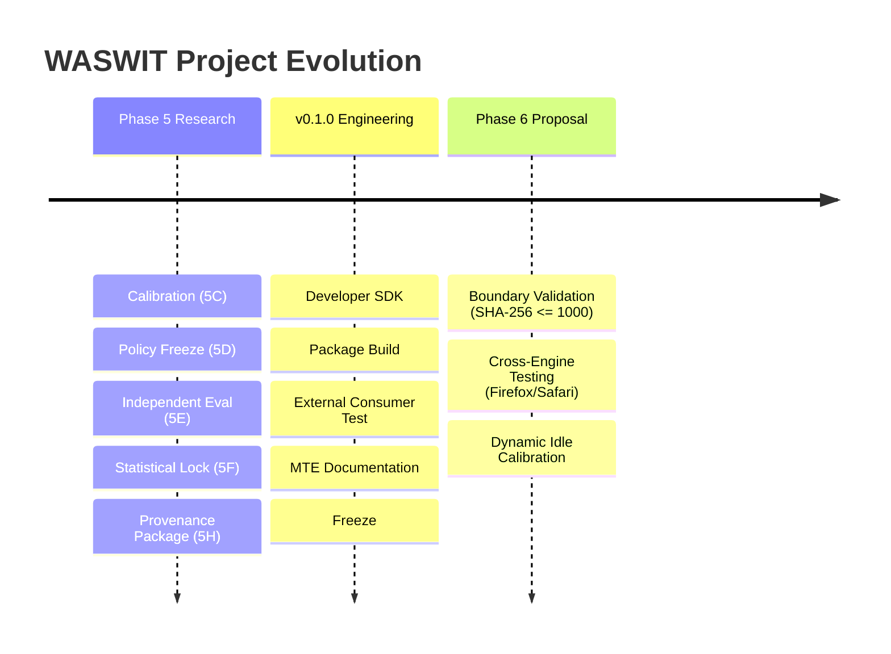

# WASWIT: Remaining Work & Project Roadmap

**Author**: WASWIT Architecture & Research Team  
**Baseline Commit**: `5c530f6f548f23e9f18a5f7b562c187eeeef024c`  
**Current Milestone**: Capstone-I Mid-Term Evaluation (MTE)  

---

## 1. Roadmap Overview & Phasing

To preserve scientific integrity, WASWIT distinguishes strictly between **Phase 5 (Frozen Research Baseline)**, **Developer SDK Engineering (v0.1.0 Ready)**, and **Future Research Extensions (Phase 6 Proposal)**.

---

## 2. Priority 1: Immediate Capstone-I MTE Execution (Current)

| Task | Scope | Acceptance Criteria | Status |
|---|---|---|---|
| **P1.1: Local Demo Reliability** | Verification | `npm run dev` serves on `http://localhost:3000` with `/developer` playground functional | **DONE** |
| **P1.2: Research Integrity Verification** | Evidence Lock | `final_evaluation_*.json` and `frozen_policy_*.json` hashes verified byte-identical | **DONE** |
| **P1.3: Build & Test Matrix Validation** | QA | 142 Vitest tests pass; 13 Playwright suites pass; production build succeeds | **DONE** |
| **P1.4: Documentation Cleanliness** | Technical Docs | Zero syntax errors in code examples; package imports standardized to `'waswit'` | **DONE** |
| **P1.5: Viva & Defense Preparation** | Presentation | 40 technical/methodological Q&As prepared in `docs/mte/VIVA_QA.md` | **DONE** |
| **P1.6: Remote Sync Authorization** | Git Operations | Explicit user confirmation to push commits `954ea43` and `5c530f6` to GitHub | **PENDING USER APPROVAL** |

---

## 3. Priority 2: Post-MTE Research Extension (Phase 6 — Proposed)

The primary scientific gap in Phase 5 is that the independent evaluation grid for SHA-256 ($2500, 7500, 12500, 17500$) only exercised the WebAssembly path ($> 1000$), leaving the JavaScript path ($\le 1000$) and the crossover boundary untested in the independent evaluation phase.

### Milestone 6.1: Sub-1000 Byte SHA-256 Evaluation Protocol
- **Objective**: Independently test input sizes $250, 500, 750, 900, 1000, 1100, 1500$ bytes to validate whether JavaScript holds a descriptive advantage over WebAssembly below 1000 bytes.
- **Acceptance Criteria**:
  1. A standalone versioned protocol (`docs/research/phase6-protocol.md`) created without modifying Phase 5 artifacts.
  2. 10 independent replicates per cell with 30 measured iterations.
  3. Pre-specified hypothesis testing using exact paired sign-permutation tests.
  4. Preserving the exact boundary between Phase 5 and Phase 6 data.

### Milestone 6.2: Multi-Browser Engine Generalization Study
- **Objective**: Execute identical workload benchmarks across Gecko (Firefox 135+), JavaScriptCore (Safari/WebKit), and Blink (Chrome 138).
- **Acceptance Criteria**:
  1. Automated Playwright harness executing all 3 browser targets on identical hardware.
  2. Empirical comparative matrix evaluating whether crossover thresholds migrate based on JS engine JIT characteristics.
  3. Engine-parameterized policy derivation specification.

---

## 4. Priority 3: Production Engineering & Packaging (v0.2.0)

| Task | Scope | Acceptance Criteria |
|---|---|---|
| **P3.1: Node.js Hybrid Loader** | SDK | Polyfill `import.meta.url` or provide Node-specific `fs.readFileSync` WASM loader fallback so unbundled CommonJS backend scripts execute without bundlers. |
| **P3.2: Automated CI/CD Workflows** | Tooling | GitHub Actions pipeline executing `cargo test`, `wasm-pack build`, `vitest run`, and `playwright test` on push. |
| **P3.3: Public npm Release** | Packaging | Verify npm registry availability, 2FA publishing, and semantic version tagging upon user authorization. |
| **P3.4: Dynamic Client Recalibration (Opt-in)** | Runtime | Optional client-side background idle calibration (`requestIdleCallback`) to tune policy thresholds to user-specific client devices. |

---

## 5. Explicit Definition of Done

A task or release is defined as **Done** if and only if:
1. **Zero Contamination**: Locked Phase 5 evaluation datasets and frozen policy JSON files are unmodified.
2. **Deterministic Code**: The selector relies strictly on pre-computed or calibrated values and introduces no unmeasured dynamic runtime overhead.
3. **Automated Verification**: `npm run build`, `npx vitest run`, and `npx playwright test` execute cleanly with zero errors.
4. **Isolated Consumer Verified**: Clean consumer package builds without internal monorepo source leakage.
5. **Clear Claims**: All documentation respects the exact statistical finding: *"The specified analysis did not establish statistically significant differences under the multiplicity-adjusted testing procedure."*
