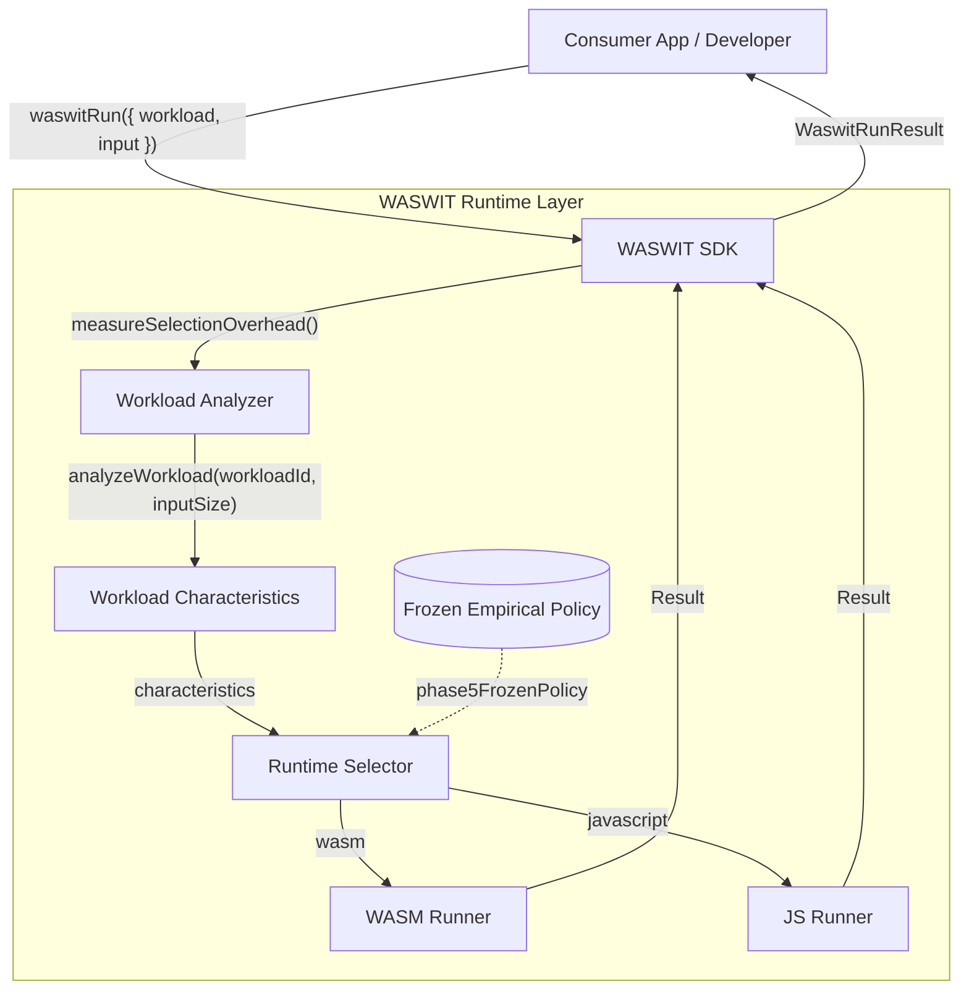

# WASWIT Developer Integration

WASWIT (Workload-Aware Intelligent Selection between JavaScript and WebAssembly) exposes a Developer SDK layer to allow external consumers to benefit from its deterministically computed execution policy.

## 1. Architecture Flow

The developer integration relies on an AOT (Ahead-of-Time) frozen empirical policy. At runtime, WASWIT acts as a synchronous interceptor that routes computational workload requests to the most efficient underlying runtime (JavaScript or WebAssembly) based strictly on input characteristics.



## 2. API Reference

### `waswitRun(options)`

The primary entry point. It accepts strongly-typed inputs and automatically routes the execution.

```typescript
import { waswitRun } from 'waswit-sdk';

const result = await waswitRun({
  workload: 'sort',
  input: new Int32Array([5, 3, 4, 1, 2])
});
```

**Returns `WaswitRunResult`:**
- `result`: The executed workload result (e.g. sorted array)
- `runtime`: The selected runtime (`"wasm"` or `"javascript"`)
- `selectionOverheadMs`: The isolated cost of analyzing the input and executing the policy rules
- `executionTimeMs`: The cost of executing the actual workload on the selected runtime

### `waswitPreload()`

WebAssembly modules incur a lazy-loading instantiation penalty. Developers can call `waswitPreload()` early in the application lifecycle (e.g., during a loading screen) to eliminate this penalty from the critical path.

```typescript
import { waswitPreload } from 'waswit-sdk';

// Call early in startup
await waswitPreload();
```

## 3. Strict Non-AI Disclaimers and Limitations

- **NO MACHINE LEARNING**: WASWIT does **not** employ neural networks, dynamic ML classifiers, or statistical predictive modeling at runtime. The policy is purely deterministic and threshold-based.
- **Empirical Freeze**: The current default policy was derived strictly from a Blink/Chromium 138 environment (Phase 5). WASWIT does **not** dynamically recalibrate thresholds in production, so performance improvements may not carry over to vastly different browser architectures or hardware platforms.
- **WASM Interop Constraints**: Developers must be aware of garbage collection pauses, serialization costs, and heap memory limits associated with WASM interoperability.
